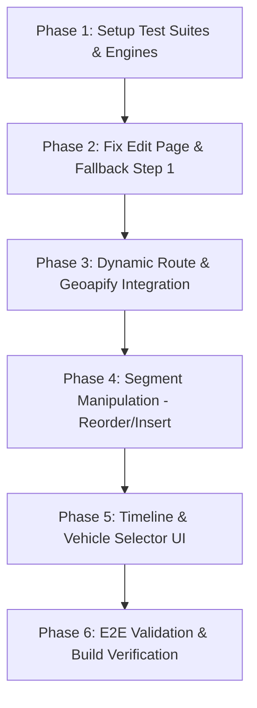

# ĐỀ XUẤT CẢI TIẾN TOÀN DIỆN & TÀI LIỆU KIỂM THỬ TDD
# TÍNH NĂNG ROUTE PLAN BUILDER (PEGAXUS FRONTEND)

> **Dự án**: Pegaxus - Hệ thống Quản lý Vận chuyển & Kiểm dịch Ngựa Xuyên Biên giới (SWP391)  
> **Tài liệu**: Technical Proposal & Test-Driven Development (TDD) Specification  
> **Trạng thái**: Đã phê duyệt (Approved)  
> **Mục tiêu**: Xóa bỏ các rào cản thao tác, tối ưu trải nghiệm điều phối viên lộ trình (Fleet Route Coordinator), hoàn thiện theo chuẩn đặc tả Swagger API Backend mà không làm thay đổi Database hay API Backend.

---

## MỤC LỤC
1. [TỔNG QUAN & PHẠM VI ẢNH HƯỞNG](#1-tổng-quan--phạm-vi-ảnh-hưởng)
2. [CHI TIẾT 7 VẤN ĐỀ CỐT LÕI & NGUYÊN NHÂN GỐC RỄ](#2-chi-tiết-7-vấn-đề-cốt-lõi--nguyên-nhân-gốc-rễ)
3. [ĐẶC TẢ GIẢI PHÁP CHỈNH SỬA CHI TIẾT](#3-đặc-tả-giải-pháp-chỉnh-sửa-chi-tiết)
   - 3.1. Sửa lỗi "cụt danh mục" tại `EditRoutePlanPage`
   - 3.2. Cơ chế tạo chặng động bằng Geoapify (Dynamic Route Creation)
   - 3.3. Cơ chế Chèn (Insert) và Đổi thứ tự (Reorder) chặng linh hoạt
   - 3.4. Bộ tính toán mốc thời gian & thời gian dừng nghỉ (Timeline & Rest Engine)
   - 3.5. Chỉ dẫn thị giác & Gợi ý điểm đến thông minh trên Bản đồ
   - 3.6. Gán Phương tiện nội bộ (`vehicleIds`) cho từng chặng
   - 3.7. Fallback an toàn tại Bước 1 (Tránh crash trắng trang)
4. [TÀI LIỆU KIỂM THỬ THEO PHƯƠNG PHÁP TDD (TEST SPECIFICATION)](#4-tài-liệu-kiểm-thử-theo-phương-pháp-tdd-test-specification)
   - 4.1. Test Suite 1: Timeline & Dwell Time Calculation (`timeline-calculator.test.ts`)
   - 4.2. Test Suite 2: Chain Continuity & Validation Engine (`route-continuity.test.ts`)
   - 4.3. Test Suite 3: Segment Insertion & Reordering Logic (`segment-reorder.test.ts`)
   - 4.4. Test Suite 4: Dynamic Segment & Payload Serialization (`toPayload.test.ts`)
   - 4.5. Test Suite 5: Edit Page Catalog Loading (`EditRoutePlanPage.test.tsx`)
   - 4.6. Test Suite 6: UI Component & User Interaction (`RoutePlanBuilder.test.tsx`)
5. [LỘ TRÌNH THỰC THI (IMPLEMENTATION PHASES)](#5-lộ-trình-thực-thi-implementation-phases)

---

## 1. TỔNG QUAN & PHẠM VI ẢNH HƯỞNG

### 1.1. Bối cảnh
Tính năng **Route Plan Builder** cho phép Điều phối viên vận tải (Fleet Route Coordinator) xây dựng lộ trình chi tiết cho Kế hoạch vận chuyển (`TransportPlan`). Một lộ trình bao gồm nhiều chặng (`segments`), đi qua các trạm nghỉ (Rest Stops), trạm thú y (Veterinary/Stable), trạm kiểm soát biên giới (Border Control Posts - BCP), cảng/sân bay và điểm đích.

### 1.2. Đánh giá tác động Backend & Database
* **Database (DB)**: **0% ảnh hưởng.** Không cần sửa đổi bất kỳ bảng, quan hệ, hay migration nào.
* **Backend API**: **0% ảnh hưởng.** Không cần thay đổi mã nguồn hay bổ sung endpoint mới. Endpoint `POST /api/v1/transport-plans/{transportPlanId}/route-plans` và `PUT /api/v1/route-plans/{routePlanId}` đã hỗ trợ đầy đủ các trường cần thiết:
  * `routeId`: `string | null` (cho phép `null` khi là chặng nối thủ công).
  * `fromLocationId` & `toLocationId`: `UUID` bắt buộc của điểm đi/đến.
  * `transportMode`: `ROAD | SEA | AIR`.
  * `plannedDepartureAt` & `plannedArrivalAt`: Hỗ trợ mốc giờ ISO date-time riêng cho từng chặng.
  * `vehicleIds`: `UUID[]` mảng ID xe nội bộ.
  * `outsourcing`: `{ transportProviderId, note }` nhà xe thuê ngoài.
* **Frontend**: **100% cải tiến tập trung ở tầng UI/UX và State Management**.

---

## 2. CHI TIẾT 7 VẤN ĐỀ CỐT LÕI & NGUYÊN NHÂN GỐC RỄ

| STT | Vấn đề / Hiện tượng | Vị trí mã nguồn | Nguyên nhân kỹ thuật | Hậu quả người dùng gặp phải |
|:---:|:---|:---|:---|:---|
| **1** | **Bị chặn khi nối 2 điểm chưa có RouteMaster** | `RoutePlanBuilder.tsx:454-474` | Hàm `selectMapLocation` chỉ tìm kiếm trong mảng `routeCatalog.find(...)`. Nếu DB chưa lưu sẵn cặp Route này, hệ thống bắn toast lỗi đỏ và hủy chọn. | User không thể vẽ tuyến mới, phải bỏ dở màn hình để sang trang `/map-assets` tạo thủ công từng tuyến. |
| **2** | **Thêm chặng xuôi 1 chiều, không sửa được ở giữa** | `RoutePlanBuilder.tsx:415-419` | `addSegment` kiểm tra cứng: `route.fromLocation.id === segments.at(-1).toLocation.id`. Chỉ cho phép thêm vào đuôi. | Nếu muốn thêm trạm nghỉ giữa chặng 2 và chặng 3, user phải xóa sạch chặng 4, 3 rồi mới thêm lại từ đầu. |
| **3** | **Thời gian các chặng bị gán dập khuôn** | `RoutePlanBuilder.tsx:499-500` | Hàm `toPayload` gán: `plannedDepartureAt = plan.departureAt` và `plannedArrivalAt = plan.arrivalAt` cho **toàn bộ các chặng**. | Mọi chặng đều chung một giờ xuất phát và giờ đến. Không thể hiện được thời gian nghỉ ngơi cho ngựa, vi phạm chuẩn vận chuyển động vật. |
| **4** | **Bản đồ không có gợi ý điểm đến kế tiếp** | `RoutePlanBuilder.tsx:611-624` | `MapViewer` chỉ nhận danh sách markers phẳng, không lọc hoặc highlight các điểm lân cận/hợp lệ khi đã chọn điểm xuất phát. | User phải "đoán mò" click thử từng ghim trên bản đồ. Nếu click trúng điểm không có route thì nhận thông báo lỗi liên tục. |
| **5** | **Bug "Cụt danh mục" khi Chỉnh sửa Route Plan** | `EditRoutePlanPage.tsx:148-149` | Props truyền vào: `locations={[...initialRoutes, ...primaryRoutes]}` và `routes={[...initialRoutes, ...primaryRoutes]}`. | Màn hình Edit chỉ chứa các điểm đã có trong lộ trình cũ. User **không thể chọn bất kỳ địa điểm hay cung đường mới nào khác**. |
| **6** | **Thiếu UI gán Xe nội bộ (`vehicleIds`)** | `SegmentCard` trong `RoutePlanBuilderParts.tsx` | Chỉ có nút mở `OutsourceSegmentDialog` để gán nhà thầu bên ngoài; không có dropdown/modal chọn xe nội bộ. | Không thể chọn xe của công ty lúc lập kế hoạch, phải chờ tới bước phân bổ nhân sự/phương tiện riêng biệt. |
| **7** | **Crash trắng trang tại Bước 1 khi sai lệch địa chỉ** | `api-adapters.ts:101` | `adaptTransportPlan` quăng `throw new Error(...)` nếu địa chỉ trong Booking không khớp chính xác với bản ghi Location nào. | Toàn bộ trang biến thành màn hình báo lỗi đỏ, user không có cơ hội tự tay chọn/sửa lại điểm xuất phát trên bản đồ. |

---

## 3. ĐẶC TẢ GIẢI PHÁP CHỈNH SỬA CHI TIẾT

### 3.1. Sửa lỗi "cụt danh mục" tại `EditRoutePlanPage.tsx`
* **Giải pháp**: Tương tự như `CreateRoutePlanPage.tsx`, khi load `EditRoutePlanPage`:
  * Gọi song song `getRoutePlan(id)`, `loadAllLocations()`, và `loadAllRoutes()`.
  * Truyền toàn bộ catalog `locations` và `routes` vào `RoutePlanBuilder`.
  * Giữ nguyên các chặng hiện tại (`initialRoutes`) và đánh dấu `edit={{ routePlanId, lastUpdatedAt }}`.

### 3.2. Cơ chế tạo chặng động bằng Geoapify (Dynamic Route Creation)
* **Giải pháp**: 
  * Khi user chọn Điểm đi A và Điểm đến B:
    1. Kiểm tra trong `routeCatalog`: Nếu có sẵn Tuyến đường (`RouteMaster`), sử dụng ngay với `routeId = found.id`.
    2. Nếu **chưa có sẵn**: Tự động gọi hàm tiện ích `previewGeoapifyRoute(A, B)`.
    3. Nhận về kết quả `distanceKm`, `durationMinutes`, và `geometry` (tọa độ đường cong mượt).
    4. Tạo một chặng mới với:
       * `routeId = undefined` (hoặc `null` khi gửi payload).
       * `fromLocationId = A.id`, `toLocationId = B.id`.
       * `transportMode = "ROAD"`.
       * `distanceKm`, `durationMinutes` lấy từ Geoapify.
  * **Lợi ích**: Không báo lỗi đỏ, không bắt user rời màn hình; lộ trình hiển thị chuẩn xác từng cung đường thực tế.

### 3.3. Cơ chế Chèn (Insert) và Đổi thứ tự (Reorder) chặng
* **Giải pháp UI/Logic**:
  * **Nút điều hướng**: Trên mỗi `SegmentCard`, thêm các nút:
    * `Move Up` (Đẩy lên trước) và `Move Down` (Đẩy xuống sau).
    * `+ Insert Stop Here`: Mở chế độ chọn một trạm dừng chèn vào giữa điểm đích của chặng trước và điểm đầu của chặng sau.
  * **Validation thông minh**: Không chặn người dùng ngay khi đang click chọn. Cho phép danh sách tạm thời có thể chưa liên tục khi đang chỉnh sửa, nhưng:
    * Đánh dấu cảnh báo viền đỏ trên card bị đứt gãy: *"Chặng này không nối tiếp từ điểm đến của chặng trước"*.
    * Chỉ vô hiệu hóa (disable) nút `Next` sang Bước 3 khi chuỗi chưa hoàn toàn hợp lệ.

### 3.4. Bộ tính toán mốc thời gian & thời gian dừng nghỉ (Timeline & Rest Engine)
* **Quy chuẩn vận chuyển ngựa (Council Regulation EC 1/2005)**: Ngựa không được di chuyển liên tục quá 8–14 tiếng mà không dừng nghỉ ăn uống.
* **Cơ chế tính toán**:
  * Tại Bước 1: User xác nhận giờ khởi hành tổng thể $T_{\text{start}}$ (mặc định lấy từ `plannedDepartureAt` của Transport Plan).
  * Tại mỗi Chặng $i$:
    * Thêm trường nhập **Thời gian dừng nghỉ (`dwellTimeMinutes`)** tại điểm đến của chặng (ví dụ: Nghỉ 60 phút tại trạm kiểm dịch/chuồng ngựa).
    * Giờ khởi hành chặng $i$:
      $$T_{\text{dep}, 1} = T_{\text{start}}$$
      $$T_{\text{dep}, i} = T_{\text{arr}, i-1} + \text{dwellTime}_{i-1} \quad (i > 1)$$
    * Giờ đến chặng $i$:
      $$T_{\text{arr}, i} = T_{\text{dep}, i} + \text{durationMinutes}_i$$
  * Cho phép user ghi đè thủ công (override) nếu cần thiết.

### 3.5. Chỉ dẫn thị giác & Gợi ý điểm đến thông minh trên Bản đồ
* Khi đang ở trạng thái chọn điểm tiếp theo:
  * Điểm xuất phát hiện tại được ghim icon nổi bật với hiệu ứng vòng tròn phát sáng (pulse animation).
  * Các địa điểm khác trên bản đồ được phân loại rõ ràng qua màu sắc/icon:
    * Màu xanh lá: Trạm nghỉ / Chuồng ngựa (`STABLE`, `REST_STOP`).
    * Màu cam: Trạm kiểm soát biên giới (`BORDER_GATE`).
    * Màu xanh dương: Điểm đích cuối cùng (`DESTINATION`).
  * Khi hover vào một marker, hiển thị khoảng cách và thời gian ước tính từ điểm hiện tại tới điểm đó.

### 3.6. Gán Phương tiện nội bộ (`vehicleIds`) cho từng chặng
* Khi một chặng được cấu hình là `INTERNAL` (không thuê ngoài):
  * Hiển thị selector chọn phương tiện (`VehicleSelect`).
  * Gọi API `getVehicles({ status: 'AVAILABLE', transportMode: 'ROAD' })`.
  * Hiển thị rõ: Tên xe, biển số, và sức chứa số lượng ngựa (`capacityHorses`).
  * Đưa `vehicleIds: [selectedVehicleId]` vào payload gửi lên Backend.

### 3.7. Fallback an toàn tại Bước 1 (Tránh crash trắng trang)
* Trong `adaptTransportPlan`:
  * Nếu không tìm thấy `from` hoặc `to` trùng khớp chính xác từ địa chỉ Booking:
    * Không quăng `throw new Error()`.
    * Đặt giá trị `from = null` hoặc `to = null`.
    * Tại Bước 1 của Wizard, hiển thị ô tìm kiếm vị trí (Location Search Autocomplete) với thông báo màu vàng: *"Vui lòng xác nhận điểm xuất phát/kết thúc trên bản đồ cho Đơn hàng này"*.
    * Cho phép Điều phối viên tự ghim/chọn điểm hợp lệ rồi mới bước sang Bước 2.

---

## 4. BỘ TEST CASES CHI TIẾT (TEST SPECIFICATION CHO TDD)

> **Hướng dẫn áp dụng cho TDD (Test-Driven Development)**:
> Bộ Test Cases dưới đây định nghĩa chi tiết các kịch bản kiểm thử, dữ liệu đầu vào (Input), các bước thực hiện (Execution Steps) và kết quả kỳ vọng (Expected Assertions) cho từng ý tưởng cải tiến đã được phê duyệt.
> 
> Developer sẽ dựa vào các tiêu chuẩn nghiệm thu (Acceptance Criteria) trong từng test case này để xây dựng kịch bản kiểm thử và hoàn thiện mã nguồn tương ứng.

---

### NHÓM 1: SỬA LỖI CATALOG KHI CHỈNH SỬA (EDIT ROUTE PLAN)

#### Test Case TC-RPB-EDT-01: Tải đầy đủ danh mục địa điểm và tuyến đường khi vào trang Chỉnh sửa
* **Mục tiêu**: Đảm bảo trang `EditRoutePlanPage` không bị "cụt đường" mà tải toàn bộ `locations` và `routes` của hệ thống để người dùng có thể thêm chặng mới.
* **Tiền điều kiện**: 
  * Người dùng có quyền `FLEET_ROUTE_COORDINATOR` hoặc `LOGISTICS_MANAGER`.
  * Có sẵn một Route Plan ở trạng thái `DRAFT` (ID: `RP-001`) gồm 2 chặng: `Paris ➔ Lyon` và `Lyon ➔ Marseille`.
  * Hệ thống có thêm các địa điểm khác trong DB: `Nice`, `Geneva`, `Milan`.
* **Các bước thực hiện**:
  1. Điều hướng đến trang `/route-plans/:routePlanId/edit` với ID `RP-001`.
  2. Quan sát network request và màn hình sau khi tải xong.
  3. Bấm nút `Next` để chuyển sang Bước 2 (Route Builder).
  4. Bấm `+ Add Segment` để mở danh sách tìm kiếm tuyến đường.
  5. Tìm kiếm địa điểm `Nice` hoặc `Milan`.
* **Kết quả kỳ vọng**:
  * Hàm `loadAllLocations()` và `loadAllRoutes()` được gọi thành công song song với `getRoutePlan(id)`.
  * Tại Bước 2, bản đồ hiển thị đầy đủ các marker `Nice`, `Geneva`, `Milan`.
  * Trong dropdown `Add Segment`, các tuyến liên quan đến `Nice`, `Milan` xuất hiện và có thể chọn được, không bị giới hạn chỉ ở `Paris`, `Lyon`, `Marseille`.

---

### NHÓM 2: TỰ ĐỘNG TÍNH ĐƯỜNG BẰNG GEOAPIFY (DYNAMIC ROUTING)

#### Test Case TC-RPB-DYN-01: Nối 2 địa điểm chưa có RouteMaster mà không bị chặn lỗi
* **Mục tiêu**: Cho phép người dùng click 2 địa điểm bất kỳ trên bản đồ để tạo chặng mới mà không bị lỗi *"No saved Route exists between these Locations"*.
* **Tiền điều kiện**:
  * Đang ở Bước 2 (Route Builder) của màn hình Tạo hoặc Chỉnh sửa Route Plan.
  * Địa điểm `Location A` (Stable Chantilly) và `Location B` (Rest Stop Dijon) có tồn tại trên bản đồ nhưng **chưa từng được tạo RouteMaster** trong bảng Tuyến đường của hệ thống.
* **Các bước thực hiện**:
  1. Click vào marker của `Location A` trên bản đồ (được chọn làm điểm xuất phát của chặng).
  2. Click vào marker của `Location B` trên bản đồ.
* **Kết quả kỳ vọng**:
  * Hệ thống KHÔNG hiển thị thông báo lỗi đỏ *"No saved Route exists..."*.
  * Hệ thống tự động kích hoạt tính năng gọi Geoapify Routing API với tọa độ của A và B.
  * Hiển thị đường vẽ polyline nối mượt mà từ A sang B trên bản đồ.
  * Một `SegmentCard` mới được tự động thêm vào danh sách bên phải với:
    * Tên: `Stable Chantilly ➔ Rest Stop Dijon`.
    * Khoảng cách (`distanceKm`) và thời gian di chuyển (`estimatedDuration`) được lấy từ Geoapify.
    * Hình thức: `ROAD`.
    * Cờ `routeId` được hiểu là `undefined` hoặc `null` (hợp lệ theo Swagger API).

#### Test Case TC-RPB-DYN-02: Ưu tiên sử dụng RouteMaster nếu cặp điểm đã được cấu hình trước
* **Mục tiêu**: Nếu 2 địa điểm đã có sẵn RouteMaster trong DB thì hệ thống phải ưu tiên gắn `routeId` có sẵn để tái sử dụng cấu hình chuẩn.
* **Tiền điều kiện**: Có tuyến `Route-101` (`Paris ➔ Lyon`) đã được định nghĩa trong hệ thống.
* **Các bước thực hiện**:
  1. Chọn điểm xuất phát là `Paris`.
  2. Chọn điểm đến là `Lyon`.
* **Kết quả kỳ vọng**:
  * Chặng được tạo thành công với thông tin và `routeId` lấy từ `Route-101`.
  * Không cần gọi thêm request tính đường ngoài của Geoapify.

---

### NHÓM 3: CHÈN (INSERT) VÀ ĐỔI THỨ TỰ (REORDER) CHẶNG LINH HOẠT

#### Test Case TC-RPB-ROD-01: Chèn một trạm dừng nghỉ vào giữa 2 chặng đã có
* **Mục tiêu**: Kiểm tra tính năng chèn chặng ở giữa lộ trình mà không bắt buộc người dùng phải xóa các chặng sau.
* **Tiền điều kiện**: 
  * Lộ trình hiện tại có 2 chặng:
    * Chặng 1: `A ➔ B` (Sequence 1)
    * Chặng 2: `B ➔ D` (Sequence 2)
  * Người dùng muốn chèn trạm nghỉ `C` vào giữa `B` và `D` để chia thành `B ➔ C` và `C ➔ D`.
* **Các bước thực hiện**:
  1. Tại Chặng 2 (`B ➔ D`), click vào menu thao tác và chọn nút `+ Chèn trạm dừng (Insert Stop)`.
  2. Chọn địa điểm trung gian `C` từ danh sách hoặc bản đồ.
  3. Xác nhận chèn.
* **Kết quả kỳ vọng**:
  * Chặng 2 cũ (`B ➔ D`) được chuyển đổi/thay thế bằng chặng `B ➔ C` (Sequence 2) và chặng `C ➔ D` (Sequence 3).
  * Thứ tự `sequenceNo` của tất cả các chặng phía sau được tự động tăng lên 1 đơn vị.
  * Lộ trình trên bản đồ tự động vẽ lại liên tục theo chuỗi: `A ➔ B ➔ C ➔ D`.

#### Test Case TC-RPB-ROD-02: Hoán đổi thứ tự chặng bằng nút Move Up / Move Down
* **Mục tiêu**: Cho phép thay đổi vị trí chặng trong danh sách và tự động cập nhật lại `sequenceNo`.
* **Tiền điều kiện**: Có 3 chặng: Chặng 1 (`A ➔ B`), Chặng 2 (`B ➔ C`), Chặng 3 (`C ➔ D`).
* **Các bước thực hiện**:
  1. Tại Chặng 2 (`B ➔ C`), bấm nút `Move Down` (hoặc kéo thả xuống dưới Chặng 3).
* **Kết quả kỳ vọng**:
  * Chặng `B ➔ C` chuyển xuống vị trí thứ 3 (Sequence 3).
  * Chặng `C ➔ D` được đẩy lên vị trí thứ 2 (Sequence 2).
  * Hệ thống hiển thị cảnh báo viền đỏ tại chặng đứt gãy: *"Chặng 2 không nối tiếp từ điểm đến của chặng 1"* (do `B ➔ C` bị chuyển đi).
  * Nút `Next` sang Bước 3 bị vô hiệu hóa (disabled) kèm thông báo lỗi cho đến khi chuỗi được nối liên tục trở lại.

---

### NHÓM 4: QUẢN LÝ THỜI GIAN & THỜI GIAN DỪNG NGHỈ (TIMELINE & REST STOPS)

#### Test Case TC-RPB-TIM-01: Tự động tính toán mốc giờ khởi hành và giờ đến theo thời gian di chuyển
* **Mục tiêu**: Loại bỏ việc gán cứng cùng 1 mốc giờ cho toàn bộ các chặng, tự động cộng dồn giờ thực tế.
* **Tiền điều kiện**:
  * Kế hoạch có giờ xuất phát tổng thể: `08:00 ngày 01/11/2026`.
  * Chặng 1 có thời gian di chuyển dự kiến: 120 phút (2 giờ).
  * Chặng 1 có thời gian dừng nghỉ tại đích (`dwellAfterMinutes`): 0 phút.
* **Các bước thực hiện**:
  1. Thêm Chặng 1 vào lộ trình.
  2. Quan sát mốc giờ hiển thị trên thẻ Chặng 1.
* **Kết quả kỳ vọng**:
  * Giờ khởi hành Chặng 1 (`plannedDepartureAt`): `08:00 01/11/2026`.
  * Giờ đến Chặng 1 (`plannedArrivalAt`): `10:00 01/11/2026` ($08:00 + 2h$).

#### Test Case TC-RPB-TIM-02: Tự động cộng dồn Thời gian nghỉ (Rest/Dwell Time) sang chặng tiếp theo
* **Mục tiêu**: Khi xe và ngựa dừng nghỉ tại trạm (cho ngựa ăn, uống nước, kiểm dịch), giờ khởi hành chặng sau phải tự động lùi lại tương ứng.
* **Tiền điều kiện**:
  * Chặng 1: Đi từ `08:00` đến `11:00` (thời gian đi 3 giờ).
  * Chặng 2: Thời gian di chuyển dự kiến 2 giờ.
* **Các bước thực hiện**:
  1. Trên thẻ Chặng 1, tại ô `Thời gian nghỉ tại trạm (Rest Time)`, nhập `60` phút.
  2. Thêm Chặng 2 vào lộ trình.
  3. Quan sát mốc giờ hiển thị trên thẻ Chặng 2.
* **Kết quả kỳ vọng**:
  * Chặng 1: Khởi hành `08:00`, đến lúc `11:00`.
  * Chặng 2: Tự động khởi hành lúc `12:00` ($11:00 + 60$ phút nghỉ).
  * Chặng 2: Giờ đến dự kiến là `14:00` ($12:00 + 2$ giờ di chuyển).

#### Test Case TC-RPB-TIM-03: Cảnh báo vi phạm thời gian di chuyển liên tục cho ngựa (Animal Welfare Alert)
* **Mục tiêu**: Hỗ trợ tuân thủ quy định EU (Council Regulation EC 1/2005) về vận chuyển động vật.
* **Tiền điều kiện**: Một chặng đường dài có thời gian di chuyển liên tục vượt quá 9 tiếng không nghỉ (ví dụ: 600 phút = 10 giờ).
* **Các bước thực hiện**:
  1. Thêm một chặng có thời gian chạy xe 600 phút mà không có trạm nghỉ trung gian.
* **Kết quả kỳ vọng**:
  * Thẻ chặng hiển thị biểu tượng cảnh báo màu vàng (Warning Badge): *"Chặng di chuyển liên tục vượt quá 9 tiếng. Cần bổ sung trạm dừng nghỉ cho ngựa theo quy chuẩn bảo vệ động vật."*
  * Không chặn hoàn toàn việc lưu nháp nhưng cảnh báo rõ ràng cho Điều phối viên.

---

### NHÓM 5: TƯƠNG TÁC BẢN ĐỒ & GỢI Ý ĐIỂM ĐẾN KẾ TIẾP (MAP UX)

#### Test Case TC-RPB-MAP-01: Làm nổi bật điểm xuất phát và các điểm đến tiềm năng
* **Mục tiêu**: Giúp người dùng dễ dàng định hướng điểm đến kế tiếp mà không phải đoán mò.
* **Tiền điều kiện**: Đã chọn điểm xuất phát Chặng 1 là `Stable Paris`.
* **Các bước thực hiện**:
  1. Quan sát bản đồ sau khi chọn điểm xuất phát.
* **Kết quả kỳ vọng**:
  * Marker `Stable Paris` đổi sang màu nổi bật (xanh lục viền vàng, có hiệu ứng pulse nhấp nháy).
  * Các marker khác trên bản đồ được phân loại biểu tượng rõ ràng:
    * Icon hình ngôi sao/chuồng ngựa cho các `STABLE` / `REST_STOP`.
    * Icon trạm kiểm soát cho `BORDER_GATE`.
    * Icon cờ đích cho `DESTINATION` của Transport Plan.
  * Hộp thông tin hướng dẫn trên đầu bản đồ hiển thị: *"Đã chọn điểm xuất phát: Stable Paris. Hãy click chọn trạm dừng hoặc điểm đến tiếp theo trên bản đồ."*

#### Test Case TC-RPB-MAP-02: Tìm kiếm và lọc điểm đến theo khoảng cách từ điểm hiện tại
* **Mục tiêu**: Tìm kiếm nhanh các trạm nghỉ nằm gần cung đường dự kiến.
* **Tiền điều kiện**: Điểm hiện tại đang dừng ở `Lyon`.
* **Các bước thực hiện**:
  1. Mở ô tìm kiếm vị trí trên bản đồ.
  2. Nhập từ khóa `Rest Stop` hoặc lọc theo danh mục `Chuồng ngựa / Trạm dừng`.
* **Kết quả kỳ vọng**:
  * Danh sách kết quả gợi ý ưu tiên hiển thị các trạm dừng có khoảng cách gần `Lyon` nhất kèm số km ước tính.
  * Khi click chọn từ danh sách tìm kiếm, bản đồ tự động bay (`flyTo`) đến vị trí đó và kích hoạt tạo chặng nối từ `Lyon`.

---

### NHÓM 6: GÁN PHƯƠNG TIỆN NỘI BỘ VÀ THUÊ NGOÀI (FLEET ASSIGNMENT)

#### Test Case TC-RPB-VEH-01: Gán Xe nội bộ (`vehicleIds`) cho chặng vận chuyển nội bộ
* **Mục tiêu**: Tận dụng trường `vehicleIds` có sẵn trong Swagger Backend để phân bổ xe ngay tại màn hình builder.
* **Tiền điều kiện**: 
  * Chặng được chọn là `INTERNAL` (Nội bộ công ty vận chuyển).
  * Hệ thống có sẵn danh sách xe khả dụng (`status = AVAILABLE`) lấy từ `getVehicles()`.
* **Các bước thực hiện**:
  1. Trên thẻ chặng, quan sát khu vực `Arrangement` (hiện đang là `Internal`).
  2. Click vào dropdown `Chọn Phương tiện (Select Vehicle)`.
  3. Chọn xe `Horse Van Pro - Biển số 29B-8888 (Sức chứa: 4 ngựa)`.
* **Kết quả kỳ vọng**:
  * Thẻ chặng hiển thị thông tin xe đã chọn kèm biển số và sức chứa.
  * Payload gửi lên server chứa: `"vehicleIds": ["uuid-cua-xe-29B-8888"]`.
  * Không xuất hiện trường `outsourcing` trong chặng này.

#### Test Case TC-RPB-VEH-02: Chuyển đổi giữa Thuê ngoài (Outsourced) và Nội bộ (Internal)
* **Mục tiêu**: Đảm bảo tính loại trừ lẫn nhau giữa `vehicleIds` và `outsourcing` theo đúng validation schema:
  `if (segment.outsourcing && segment.vehicleIds?.length) => Báo lỗi`.
* **Các bước thực hiện**:
  1. Chặng đang có xe nội bộ `29B-8888`.
  2. Bấm chuyển hình thức sang `Outsource`.
  3. Chọn nhà thầu `Lufthansa Cargo Air Charter` và nhập ghi chú chuyến bay.
* **Kết quả kỳ vọng**:
  * Hệ thống tự động xóa bỏ `vehicleIds` của xe nội bộ.
  * Cập nhật thông tin `outsourcing: { transportProviderId, note }`.
  * Payload gửi lên server hợp lệ, không bị lỗi vi phạm ràng buộc.

---

### NHÓM 7: XỬ LÝ NGOẠI LỆ BƯỚC 1 (FALLBACK CHO BOOKING)

#### Test Case TC-RPB-FAL-01: Tự chọn điểm xuất phát/kết thúc khi Booking không khớp Location ID
* **Mục tiêu**: Tránh crash màn hình trắng báo lỗi khi dữ liệu Booking bị lệch địa chỉ.
* **Tiền điều kiện**: Transport Plan có `booking.originAddress = "Trang trại ngựa ABC, Ngoại ô Paris"` nhưng địa chỉ này chưa có ID chính xác trong bảng Location.
* **Các bước thực hiện**:
  1. Mở trang tạo Route Plan cho Transport Plan trên.
  2. Quan sát Bước 1 (Transport Details).
* **Kết quả kỳ vọng**:
  * Trang KHÔNG bị văng màn hình trắng báo lỗi `throw new Error(...)`.
  * Tại thẻ `Origin`, hiển thị hộp cảnh báo màu vàng: *"Không tự động nhận diện được địa điểm từ đơn hàng. Vui lòng chọn địa điểm tương ứng trên hệ thống."*
  * Cung cấp ô tìm kiếm / dropdown cho phép Điều phối viên gõ tìm kiếm và chọn `Stable Paris Hub`.
  * Sau khi chọn xong, nút `Next` sang Bước 2 sáng lên và cho phép tiếp tục bình thường.

---

### NHÓM 8: KIỂM SOÁT TÍNH TOÀN VẸN & LƯU KẾ HOẠCH (SAVE & VALIDATION)

#### Test Case TC-RPB-SAV-01: Lưu Nháp (Save Draft) thành công với đầy đủ dữ liệu mới
* **Mục tiêu**: Kiểm tra payload cuối cùng gửi lên API `POST /api/v1/transport-plans/{id}/route-plans`.
* **Tiền điều kiện**: Đã hoàn thành xây dựng lộ trình gồm 3 chặng liên tục từ Origin đến Destination:
  * Chặng 1: Dùng Geoapify động (`routeId: null`), có gán xe nội bộ, thời gian khởi hành `08:00`.
  * Chặng 2: Tuyến Master có sẵn (`routeId: 'r-101'`), có thời gian nghỉ 60 phút.
  * Chặng 3: Thuê ngoài (`outsourcing: { transportProviderId: '...' }`).
* **Các bước thực hiện**:
  1. Chuyển sang Bước 3 (Review & Save).
  2. Nhập ghi chú lộ trình `routeNote: "Lộ trình kiểm dịch chuẩn qua trạm Dijon"`.
  3. Bấm nút `Lưu Nháp (Save Draft)`.
* **Kết quả kỳ vọng**:
  * API `POST /api/v1/transport-plans/{id}/route-plans` được gọi với đúng cấu trúc:
    * `routeType`: `"PRIMARY"`
    * `action`: `"SAVE_DRAFT"`
    * `routeNote`: `"Lộ trình kiểm dịch chuẩn qua trạm Dijon"`
    * `segments`: Mảng 3 chặng với `sequenceNo` lần lượt là 1, 2, 3.
    * Mốc thời gian `plannedDepartureAt` và `plannedArrivalAt` của từng chặng phản ánh đúng chuỗi thời gian đã tính toán cộng dồn.
  * Hiển thị toast thông báo thành công: *"Lưu bản nháp kế hoạch lộ trình thành công."*

#### Test Case TC-RPB-SAV-02: Bị chặn khi chuỗi lộ trình còn đứt gãy
* **Mục tiêu**: Đảm bảo không cho phép gửi duyệt pháp lý nếu chuỗi chặng chưa nối liền từ đầu đến cuối.
* **Tiền điều kiện**: Chặng 1 kết thúc tại `Lyon`, nhưng Chặng 2 bắt đầu từ `Nice` (bị thiếu chặng `Lyon ➔ Nice`).
* **Các bước thực hiện**:
  1. Tại Bước 2, quan sát trạng thái nút `Next`.
  2. Cố gắng chuyển sang Bước 3 và bấm `Submit for legal review`.
* **Kết quả kỳ vọng**:
  * Nút `Next` bị vô hiệu hóa hoặc hệ thống cảnh báo rõ ràng: *"Chặng 2 bị ngắt quãng với chặng 1. Vui lòng nối liền lộ trình trước khi lưu."*
  * Không gửi request lỗi lên Backend.

---

## 5. LỘ TRÌNH THỰC THI (IMPLEMENTATION PHASES)

1. **Giai đoạn 1**: Thiết lập các Test Suites theo đặc tả TDD ở trên (`timeline-calculator.test.ts`, `route-continuity.test.ts`, `segment-reorder.test.ts`). Chạy test và xác nhận trạng thái **FAIL (Red)**.
2. **Giai đoạn 2**: Sửa bug "cụt danh mục" tại `EditRoutePlanPage.tsx` và thêm cơ chế Fallback thân thiện tại Bước 1 `adaptTransportPlan`.
3. **Giai đoạn 3**: Triển khai `previewGeoapifyRoute` khi user chọn 2 điểm chưa có sẵn trong `routeCatalog`. Cập nhật `toPayload` cho phép `routeId: undefined`.
4. **Giai đoạn 4**: Bổ sung nút `Move Up`, `Move Down`, và `+ Insert Stop` trên `SegmentCard`.
5. **Giai đoạn 5**: Bổ sung trường nhập thời gian nghỉ (`dwellAfterMinutes`) và ô chọn xe nội bộ (`vehicleIds`).
6. **Giai đoạn 6**: Chạy lại toàn bộ test suite đảm bảo đạt **PASS (Green)**, kiểm tra `pnpm build` không có lỗi lint hoặc TypeScript.

---

> **Ghi chú cho Developer**: Toàn bộ các cải tiến trên tuân thủ nghiêm ngặt nguyên tắc **Zero Backend / Zero Database Impact**. Mọi dữ liệu serialize lên server đều khớp hoàn hảo với Swagger model của `Pegaxus.Service.RoutePlanService.Request.SaveRequest`.
