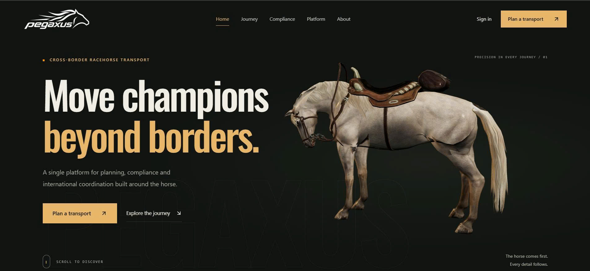
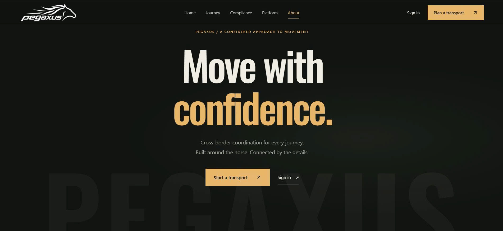
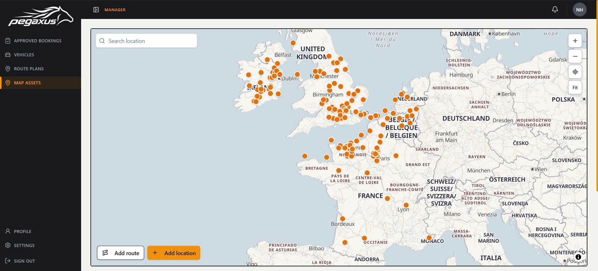
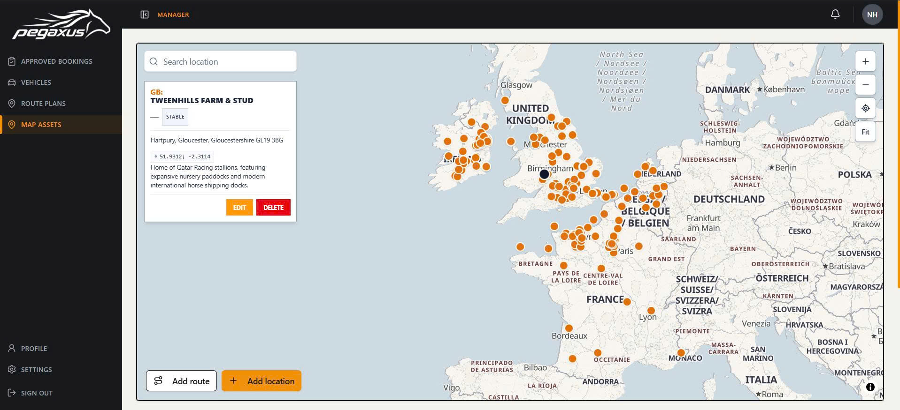

# Pegaxus

**Racehorse Cross-Border Transport & Quarantine Logistics Management System**

[](https://github.com/HKBDU/pegaxus-fe/actions/workflows/quality.yml)
[](https://react.dev/)
[](https://www.typescriptlang.org/)
[](./LICENSE)

Pegaxus brings transport booking, route planning, compliance documentation, and billing into one web application for cross-border racehorse logistics. This repository contains the React frontend, developed for SWP391 (Software Development Project).

[Interface Preview](#interface-preview) | [Capabilities](#capabilities) | [Getting Started](#getting-started) | [Configuration](#configuration) | [Development](#development)

## Interface Preview

### Landing Page



| International Transport | About Pegaxus |
| :---: | :---: |
|  |  |

### Map Workspace

The map assets workspace provides a geographic view of transport locations, with location search and tools for managing locations and routes.





## Capabilities

| Area | Frontend Workflows |
| :--- | :--- |
| Customer portal | Horse profiles, transport bookings, booking details, and status history. |
| Transport planning | Approved bookings, transport plans, primary routes, contingency routes, and return routes. |
| Maps and fleet | Map assets, location management, route previews, vehicles, and transport providers. |
| Compliance | Requirement catalogs, dossier templates, document submission and review, authority submissions, quarantine evidence, and customs clearance evidence. |
| Operations | Personnel assignments, route change decisions, and dossier audit history. |
| Accounts and billing | Authentication, role-based access, employee account management, invoices, and payment workflows. |

Some workflows include mock data for development. Backend connectivity and mock configuration determine which data is shown; see [Configuration](#configuration).

## Technology

| Layer | Technologies |
| :--- | :--- |
| Application | React 19, TypeScript 6, Vite 8, React Router 7 |
| Data and state | TanStack Query, TanStack Table, Axios, Zustand |
| Forms and validation | React Hook Form, Zod |
| Interface | Tailwind CSS 4, Radix UI, Bootstrap, Lucide |
| Mapping | MapLibre GL, react-map-gl, Geoapify |
| Documents | React PDF, PDF.js |
| Tooling | pnpm, Oxlint, Prettier, GitHub Actions |

Dependency versions are maintained in [package.json](./package.json) and [pnpm-lock.yaml](./pnpm-lock.yaml).

## Getting Started

### Requirements

- Node.js 22 LTS, matching the major version used in CI.
- pnpm 11.22.0, pinned in `package.json`.
- A running Pegaxus backend for authenticated API workflows.
- A Geoapify API key for map styles, location search, and route previews.

### Local Setup

1. Clone the repository and install dependencies:

   ```sh
   git clone https://github.com/HKBDU/pegaxus-fe.git
   cd pegaxus-fe
   pnpm install --frozen-lockfile
   ```

2. Copy the environment template using the command for your shell.

   PowerShell:

   ```powershell
   Copy-Item .env.example .env
   ```

   macOS / Linux:

   ```sh
   cp .env.example .env
   ```

3. Set `VITE_API_URL` to your backend API URL. Add `VITE_GEOAPIFY_API_KEY` to enable the map integrations. Review the mock flags below before using live backend data.

4. Start the development server:

   ```sh
   pnpm run dev
   ```

Open the URL printed by Vite, normally `http://localhost:5173`.

## Configuration

The main environment settings are listed below. Use [.env.example](./.env.example) as the starting point and restart Vite after changing environment values.

| Variable | Template Value / Default | Purpose |
| :--- | :--- | :--- |
| `VITE_API_URL` | `http://localhost:5001/api/v1` in the template | Required backend API base URL. |
| `VITE_GEOAPIFY_API_KEY` | Not set | Geoapify map styles, geocoding, place search, and road route previews. |
| `VITE_USE_MOCK_PROFILE` | `false` | Enables profile mock data in development when set to `true`. |
| `VITE_BOOKING_API_MOCKS` | `false` | Enables booking mock data in development when set to `true`. |
| `VITE_COMPLIANCE_API_MOCKS` | `false` | Enables mock data for compliance catalog and dossier workflows. |
| `VITE_PERSONNEL_API_MOCKS` | Enabled when unset | Set to `false` to use the personnel backend APIs. |
| `VITE_INVOICE_API_MOCKS` | `true` in the template; enabled by default outside production | Set to `false` to use the invoice backend APIs. Production builds use the real API. |
| `VITE_ENABLE_FLOW3_MOCKS` | Disabled when unset | Set to `true` for transport and route planning mocks in development. |
| `VITE_FLEET_API_MOCKS` | Disabled when unset | Set to `true` for vehicle and transport provider mock data. |

For backend integration, set the mock flags to `false`, including the personnel and invoice flags that otherwise default to mock data.

Vite embeds `VITE_` values in the client bundle at build time. Use browser-safe configuration only; keep server credentials outside these variables. For Geoapify, use a key restricted to the application's allowed origins.

## Development

### Commands

| Command | Purpose |
| :--- | :--- |
| `pnpm run dev` | Start the Vite development server. |
| `pnpm run lint` | Run Oxlint. |
| `pnpm run check:cycles` | Check source imports for circular dependencies. |
| `pnpm run build` | Run TypeScript checks and generate the production bundle in `dist/`. |
| `pnpm run preview` | Serve the production bundle locally for inspection. |

### Repository Layout

```text
src/
  app/          Application routing, providers, and root component
  assets/       Images, icons, and other bundled assets
  features/     Domain modules: bookings, horses, routes, dossiers, invoices
  lib/          API client, environment configuration, and integrations
  locales/      Locale resources
  shared/       Reusable components, layouts, hooks, types, and utilities
  styles/       Shared styles
  main.tsx      Application entry point
public/         Public assets
scripts/        Repository checks
sreenshots/     README interface captures
.github/        CI workflows and pull request template
```

### Contribution Workflow

See [CONTRIBUTING.md](./CONTRIBUTING.md) for development conventions and [RULESET.md](./RULESET.md) for branch and pull request naming rules.

The [Quality workflow](./.github/workflows/quality.yml) validates pull request metadata, runs lint, and builds the frontend for `main` and `dev`. Use the [pull request template](./.github/PULL_REQUEST_TEMPLATE.md) when submitting changes.

## Production Build

```sh
pnpm run build
pnpm run preview
```

Deploy the generated `dist/` directory to a static host. Configure a fallback to `index.html` for client-side routes, as shown in [nginx.conf](./nginx.conf). Set production environment values before building; changing container environment variables after the build does not update the client bundle.

The repository also includes a [Dockerfile](./Dockerfile) and [Compose configuration](./docker-compose.yml). The Dockerfile currently expects `package-lock.json`, while this repository tracks `pnpm-lock.yaml`; the container build must be aligned with pnpm before use.

## License

Developed for SWP391 (Software Development Project). Licensed under [Apache License 2.0](./LICENSE).
