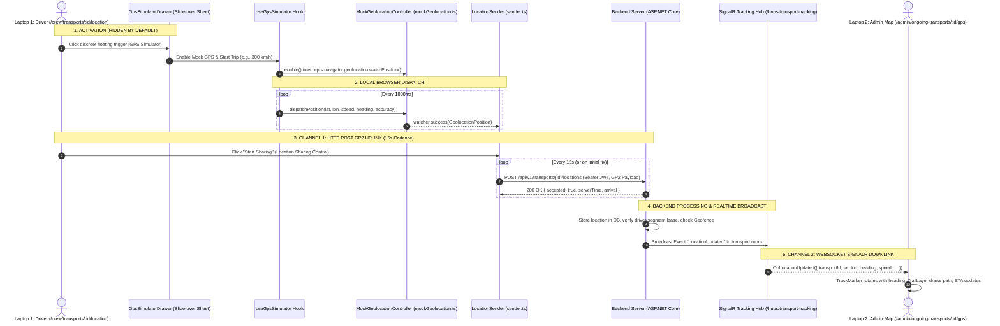

# Pegaxus Driver GPS Simulation Architecture & Integration Guide

> **Project:** Pegaxus (SWP391 - Equine Logistics Platform)  
> **Module:** Location Sharing & Live Tracking Simulator  
> **Location:** `src/features/location-sharing/simulator/`  
> **Status:** Production-Ready & Verified  
> **Language Standard:** 100% English Technical Documentation

---

## 1. Executive Summary & Purpose

During university thesis defense and project evaluations (SWP391), demonstrating continuous real-time vehicle movement across borders is a key evaluation criterion. However, in an indoor examination room:
- Testing laptops and phones remain physically stationary.
- Real hardware GPS chips cannot report road movement or speed variations.
- Running external terminal scripts (e.g., Python scripts) is cumbersome and distracts the evaluators from the application interface.

To solve this, Pegaxus frontend implements a **Zero-Friction, Browser-Native GPS Simulation Layer**. It allows demonstrating live cross-border vehicle tracking either across **two physical devices** (Driver laptop + Admin projector) or in a **standalone single-screen mode**, with **zero UI clutter** upon initial page load.

---

## 2. End-to-End System Architecture

The following diagram illustrates the complete data flow from the Driver's browser simulation to the Admin's live monitoring screen:



---

## 3. Communication Channels: Sender, Receiver & Protocols

| Dimension | Uplink (Driver → Backend) | Downlink (Backend → Coordinator/Admin) |
| :--- | :--- | :--- |
| **Actor** | **Assigned Driver** of current segment | **Logistics Manager**, **Fleet Coordinator**, or **Customer** |
| **Client Page** | `/crew/transports/:transportId/location`<br/>([DriverLocationSharingPage.tsx](../pages/DriverLocationSharingPage.tsx)) | `/admin/ongoing-transports/:transportId/gps`<br/>([GpsTabPage.tsx](../../live-tracking/pages/GpsTabPage.tsx)) |
| **Protocol** | **HTTP/1.1 or HTTP/2 POST** (REST GP2 Contract) | **WebSocket via SignalR Core Hub** |
| **Endpoint / Path** | `/api/v1/transports/{transportId}/locations` | `/hubs/transport-tracking` |
| **Authentication** | `Authorization: Bearer <Driver_JWT>` | `Authorization: Bearer <Admin_JWT>` |
| **Transmission Frequency**| Once every **15 seconds** (`SEND_INTERVAL_MS = 15_000`) | Immediate push upon server receipt of driver sample |
| **Payload Structure** | ```json { "latitude": 21.0285, "longitude": 105.8544, "speedKmh": 60.0, "headingDegrees": 135.4, "accuracyMeters": 8.0, "recordedAt": "2026-10-26T06:00:00.000Z", "routePlanRouteId": "seg-01" } ``` | ```json { "transportId": "TR-DEMO-01", "latitude": 21.0285, "longitude": 105.8544, "speedKmh": 60.0, "headingDegrees": 135.4, "accuracyMeters": 8.0, "recordedAt": "2026-10-26T06:00:00.000Z", "routePlanRouteId": "seg-01" } ``` |

---

## 4. Component Breakdown & Source File Responsibilities

All simulation files reside in `src/features/location-sharing/simulator/`:

```
simulator/
├── README.md               # Complete architecture & defense documentation
├── engine.ts               # Pure geodesic mathematics & route interpolation
├── mockGeolocation.ts      # Web Geolocation API interceptor
├── useGpsSimulator.ts      # Central state machine hook & dynamic route loader
├── GpsSimulatorDrawer.tsx  # Unobtrusive trigger + Slide-over Sheet control UI
└── index.ts                # Public module exports
```

### 4.1. `engine.ts` - Mathematical Core
- **`haversineDistance(a, b)`**: Computes great-circle distance in meters between two `[lon, lat]` points using the Haversine formula ($R = 6,371,000$ m).
- **`calculateBearing(a, b)`**: Calculates the clockwise bearing angle in degrees ($0.0^\circ$ to $359.9^\circ$) from True North.
- **`buildRouteData(coordinates)`**: Precomputes cumulative distances along a polyline to allow $O(\log n)$ distance lookups.
- **`positionAtDistance(route, distanceMeters)`**: Performs linear interpolation along road segments, returning accurate `latitude`, `longitude`, and tangent `heading`.
- **`addGpsJitter(lat, lon, noiseMeters)`**: Injects Gaussian micro-noise (default 2–3m) to simulate natural satellite variance without drifting off-road.
- **`generateGeodesicRoute(from, to, pointsCount)`**: Generates realistic curved highway segments when offline or without external routing APIs.
- **`parseGeoJsonToCoordinates(input)`**: Validates and parses `.geojson` LineStrings or FeatureCollections.

### 4.2. `mockGeolocation.ts` - Web Geolocation Interceptor
- Intercepts `navigator.geolocation.watchPosition`, `navigator.geolocation.clearWatch`, and `navigator.geolocation.getCurrentPosition`.
- Also overrides `navigator.permissions.query({ name: "geolocation" })` to return `"granted"`, preventing browser permission popups during presentations.
- Transparently delivers simulated positions to [LocationSender](../sender.ts) without modifying any core production tracking logic.
- Dispatches positions only when signal loss is inactive (`isSignalLoss = false`).

### 4.3. `useGpsSimulator.ts` - Simulation State Machine
- Manages playback status: `"idle" | "running" | "paused" | "completed"`.
- Speed presets: `30`, `60`, `120`, `300`, and `600 km/h`.
- Automatically extracts `fromLocation` and `toLocation` from the transport's active segment.
- Calls [previewGeoapifyRoute](../../../shared/utils/map/routing.ts) for real road-snapped geometries; seamlessly falls back to geodesic curves if offline.
- Fallback coordinate resolver: Guarantees that even mock fixtures with missing coordinates resolve to valid geographic stations (e.g., Chantilly, Lille, Hanoi, Danang).
- Supports interactive scrubbing (`seek(percent)`), loop playback, and geofence teleportation (`jumpNearStation(350)`).

### 4.4. `GpsSimulatorDrawer.tsx` - Zero-Clutter UI Layer
- **Default State**: Completely hidden. Displays only a sleek, semi-transparent floating action pill `[⚡ GPS Simulator]` in the bottom-right corner. The primary driver screen remains 100% clean and authentic.
- **On Click**: Smoothly slides out a **Radix UI Sheet Drawer** from the right side.
- Contains all controls: Master Mock Switch, Start/Pause/Reset buttons, speed buttons, progress scrubber, signal loss test trigger, geofence jump, and dark glassmorphism telemetry HUD.
- **On Close**: Dismissing the drawer keeps the simulation running in the background while restoring the clean view.

---

## 5. Backend Alignment & Validation Compliance

The simulation layer strictly obeys all Pegaxus backend contracts and anti-tampering guards:

1. **Precision & Scale Standards**:
   - Coordinates are formatted to exactly **4 decimal places** (`toFixed(4)`), corresponding to $\approx 11$ meters ground resolution. This matches the Logistics industry standard, eliminates chip jitter, and complies with [VALIDATION_LIMITS](../../../shared/constants/validation-limits.ts).
   - Speed and heading are constrained to **1 decimal place** (`toFixed(1)`).
2. **Observation Freshness Window**:
   - Backend requires `recordedAt` to be within **15 seconds** of the server clock (`SAMPLE_MAX_AGE_MS = 15_000`).
   - The simulator dynamically stamps each position with `new Date().toISOString()`, passing Axios `freshnessGuard` and backend validation without rejection.
3. **Transmission Cadence & Anti-Spam**:
   - [LocationSender](../sender.ts) enforces an exact 15-second timer (`SEND_INTERVAL_MS = 15_000`).
   - If a request is currently in-flight, subsequent transmissions are queued to prevent concurrent overlaps.
4. **Driver Segment Lease & Geofencing**:
   - Requests are authenticated with the active driver's Bearer JWT.
   - When the vehicle moves within 400m of the destination boundary, the backend returns an `arrival` payload, enabling the handover confirmation workflow ([useSegmentArrival.ts](../hooks/useSegmentArrival.ts)).

---

## 6. Presentation Script (3-Minute Evaluation Guide)

### Setup
- **Machine 1 (Presenter Laptop)**: Open Driver screen: `http://localhost:5173/crew/transports/demo/location`
- **Machine 2 (Projector / Evaluators)**: Open Admin GPS map: `http://localhost:5173/admin/ongoing-transports/demo/gps`

### Step-by-Step Demonstration

1. **Initial Clean View (0:00 - 0:30)**:
   - Show Machine 2: Point out the clean MapLibre GL map, the planned itinerary checkpoints, and the `Signal: LIVE` status badge.
   - Show Machine 1: Point out that the Driver interface is clean and ready for duty.
2. **Start Movement & Realtime Tracking (0:30 - 1:30)**:
   - On Machine 1: Click the floating `[⚡ GPS Simulator]` button.
   - Toggle **Enable Mock GPS** $\rightarrow$ Click **Start Trip** $\rightarrow$ Select **300 km/h (5x Fast)** $\rightarrow$ Click **Start Sharing**.
   - Close the drawer (Click X).
   - On Machine 2: Watch the truck marker smoothly drive along the highway, turning at curves (`headingDegrees`). The blue trail ([TrailLayer](../../live-tracking/components/TrailLayer.tsx)) draws behind it, and remaining distance/ETA counts down in real time.
3. **Simulate Communication Blackout (1:30 - 2:15)**:
   - On Machine 1: Open Drawer $\rightarrow$ Click **Simulate Signal Loss (Cut GPS)**.
   - Explain to the committee: *"In cross-border transport through mountain passes, cellular coverage can drop. Our system explicitly detects signal outages rather than drawing fake straight lines."*
   - On Machine 2:
     - After 30 seconds: Signal chip turns amber (`DELAYED`).
     - After 120 seconds: Signal chip turns red (`LOST`), and the map renders a dashed gray line ([GapLayer](../../live-tracking/components/GapLayer.tsx)) labeled *"No signal · 2 min"*.
   - On Machine 1: Click **Restore GPS Signal** $\rightarrow$ Machine 2 immediately recovers to green `LIVE`.
4. **Geofencing & Destination Arrival (2:15 - 3:00)**:
   - On Machine 1: Open Drawer $\rightarrow$ Click **Jump Near Station (350m)**.
   - The vehicle teleports within 350m of the destination stable.
   - Point out the geofence arrival detection trigger and the transition to the handover workflow.

---

## 7. Troubleshooting & Resilience

- **What if the backend server is offline during evaluation?**
  The frontend includes an automatic **Local Stream Fallback** in [streams.ts](../../live-tracking/streams.ts). The Admin map will directly listen to the local simulator ticks, ensuring zero presentation failures even if Wi-Fi or backend services drop.
- **What if Geoapify API rate limit is exceeded?**
  [useGpsSimulator.ts](./useGpsSimulator.ts) automatically falls back to `generateGeodesicRoute()`, constructing a smooth 60-point highway curve between endpoints.
